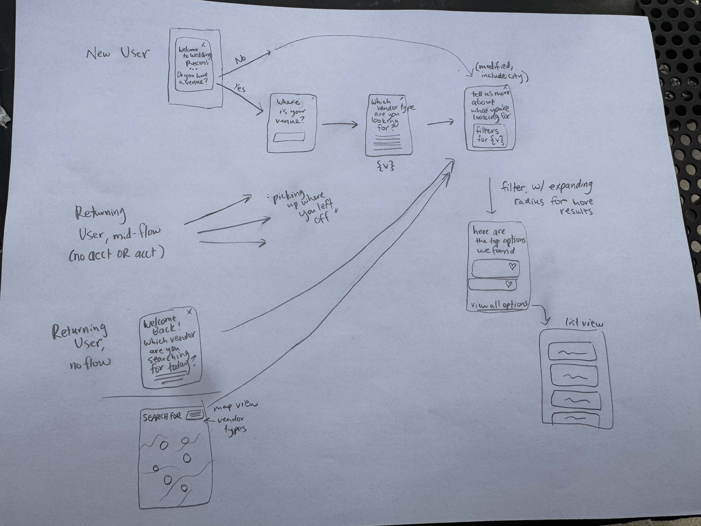

# Customer journey implementation plan

Status: engineering handoff, 31 October 2026, revised the same day after a product/engineering review. Application implementation has not started as part of this planning task. Google ratings are a fast follow, not a dependency for the first release. Review decisions are folded into the requirements below; anything still undecided is listed under [Open questions](#open-questions-from-the-31-october-review).

## Goal and context

Help couples find a manageable starting set of wedding vendors that match their preferences and are nearby. Ask only for information needed for the current vendor category. Give users three suggestions, a complete results feed, and a map, all backed by the same matching rules and search state. Returning visitors should resume their search or choose their next vendor without repeating setup.

This changes discovery and the customer journey. It does not replace the vendor directory, recon system, Planning Hub, verification system, or existing list-feed cards. Preserve those working systems and extend them.

The intended reader is an engineer new to the repository. Implement the milestones in order; each has an observable completion condition. Do not make production data changes or run billed vendor-research APIs merely to test the UI.

## Design and source references

- [Figma user journey diagram](https://www.figma.com/design/IFtSIpXiq7aTzWkApqMkJF?node-id=2-732): first visits, returning visitors, map interactions, arrows, and destination notes.
- [Figma implementation handoff](https://www.figma.com/design/IFtSIpXiq7aTzWkApqMkJF?node-id=43-258): approved semantics, original drawing, radius reference states, and regression examples.
- [Original drawing in Figma](https://www.figma.com/design/IFtSIpXiq7aTzWkApqMkJF?node-id=43-262).
- [25-mile map reference](https://www.figma.com/design/IFtSIpXiq7aTzWkApqMkJF?node-id=43-274) and [50-mile reference](https://www.figma.com/design/IFtSIpXiq7aTzWkApqMkJF?node-id=43-432). The drawn circles are schematic; production must use real geographic geometry.
- [Read-only matching audit](../mockups/customer-journey-v1/matching-feasibility-audit.json): 2,223 live vendors inspected on 31 October. This is a dated sample, not a permanent assertion about production counts.

| Screen | Purpose | Figma |
| --- | --- | --- |
| 01 | Ask whether the visitor has a venue | [Welcome](https://www.figma.com/design/IFtSIpXiq7aTzWkApqMkJF?node-id=2-763) |
| 02 | Identify a booked venue, with city fallback | [Venue location](https://www.figma.com/design/IFtSIpXiq7aTzWkApqMkJF?node-id=2-803) |
| 03 | Choose a city when still searching for a venue | [Search area](https://www.figma.com/design/IFtSIpXiq7aTzWkApqMkJF?node-id=2-842) |
| 04 | Choose one vendor type | [Category grid](https://www.figma.com/design/IFtSIpXiq7aTzWkApqMkJF?node-id=2-882) |
| 05 | Venue budget, one guest count, setting, Advanced | [Venue preferences](https://www.figma.com/design/IFtSIpXiq7aTzWkApqMkJF?node-id=2-979) |
| 06 | Photography budget, style, Advanced | [Photo preferences](https://www.figma.com/design/IFtSIpXiq7aTzWkApqMkJF?node-id=2-1022) |
| 07 | Up to three suggested matches | [Suggestions](https://www.figma.com/design/IFtSIpXiq7aTzWkApqMkJF?node-id=2-1067) |
| 08 | Existing list-feed cards with the new category heading and preference pills | [Full feed](https://www.figma.com/design/IFtSIpXiq7aTzWkApqMkJF?node-id=2-1138) |
| 09 | One vendor type, inline key filters, map and Advanced sheets | [Map](https://www.figma.com/design/IFtSIpXiq7aTzWkApqMkJF?node-id=2-1215) |
| 10 | Resume unfinished work | [Resume](https://www.figma.com/design/IFtSIpXiq7aTzWkApqMkJF?node-id=2-1321) |
| 11 | Show all 11 vendor types immediately | [Returning user](https://www.figma.com/design/IFtSIpXiq7aTzWkApqMkJF?node-id=2-1358) |

The diagram's small destination cards are journey requirements, not completed screen designs. Existing mockups use illustrative vendors/counts. Preserve the user's latest Figma edits: inspect the live nodes before editing, change only the intended controls, and never regenerate the entire file from old local SVGs. The old files under `mockups/customer-journey-v1` are historical snapshots, not the current visual source of truth. Do not run their generator or old mutation scripts to update Figma.

### Original handwritten journey



The drawing establishes the two first-visit branches, unfinished-flow resume, returning-user category selection, suggested results, list feed, and map. The Figma diagram extends it with Advanced sheets, account/save return, and proposed downstream destinations. Later decisions below take precedence over ambiguous details in the sketch.

## Accepted requirements

1. A suggestion must match every active filter and be within the search radius. Missing information is not a confirmed match.
2. Start at 25 miles from the selected venue location or city centroid. Expand along a per-type ladder, stopping at the first step with at least five confirmed matches. Fixed-location types (`FIXED_LOCATION_TYPES`: venue, hotel, dress) use 25 → 50. Service-area types (everything else) use 25 → 50 → 100 → 150, because their pin is a home base and they routinely travel; from Vail (74 miles from Denver) or Aspen/Steamboat (105–110) a 50-mile cap would exclude every Denver photographer. Rank after finding the eligible set, then show at most three suggestions.
3. One to four confirmed matches is a valid result. Zero confirmed matches produces a dedicated screen with an Adjust filters CTA. Full results retain the existing partial-match tier.
4. Include equality: a $5,000 starting fee fits a $5,000 budget; capacity 150 accommodates 150 guests.
5. Venue budget is a package/event-fee total. Use package prices directly and estimated package prices for convertible units. Use the user's actual guest count for per-person conversion.
6. Catering budget is per person. The caterer screen does not ask for guest count. Reuse the shared guest count when the couple already gave one (for example on the venue screen); without it, the roughly 12 caterers quoting per package or per item stay partial on price rather than adding a field.
7. Guest count is one number, not a minimum/maximum range. Compare it with the stored maximum capacity.
8. Price comparisons must refer to the selected service scope. A coordination fee cannot establish a full-planning fee; a bouquet cannot establish full-service wedding-flower pricing.
9. Florist budget must be at least the greater of the applicable starting price and applicable minimum spend. Both must refer to comparable units and service scope. Minimum spend folds into this one budget comparison; it is not a second budget control. A bouquet-only (`per_item`) price is partial against a total floral budget.
10. Hotel-block price belongs under Advanced, not among default controls. Unknown prices remain unknown even when the filter exists.
11. Reuse the current full/partial/excluded matcher and the existing ranking, with one change: the final key ranks **distance in 10-mile bands** from the search anchor, then a stable vendor-ID tie-break. Exact miles let city-centroid vendors (photos 121 of 276, band 70 of 106, planner 95 of 162) measure 0.0 miles from a city anchor and beat every vendor whose real address is known, and all tie, so every couple saw the same three. Keep verified, price presence, and photo presence before distance. **Verified-first applies to suggestions unchanged, with no cap on verified slots** (decided 31 October). Do not introduce a recon-confidence score.
12. Vendor type is single-select, and **this replaces multi-type browsing everywhere in Explore**, not only in the guided journey. Default type: the last type used, else Venue. Legacy multi-type URLs fall back to their first valid type. Vendor-name search still spans all types. Setting/style can still be multi-select. All 11 vendor types are visible immediately on screen 11.
13. Default (non-Advanced) controls per type are fixed by the [category controls table](#default-controls-per-category). Everything else lives under Advanced.
14. Use a radius slider and lightly display the geographic boundary. Preserve edit/back/close, category-specific preferences, list/map state, vendor round trips, and sign-in save intent.
15. Google rating and rating count are a fast follow. Do not add rating-driven sorting, rating calls, or a rating dependency to the first release.
16. Ask for an optional wedding **month/year** once, on the location step; it applies to every category. Map it to the existing season price tiers. Day of week stays unknown, so prices keep their "starting at" label.
17. Planner price comparisons are **per service tier**: a couple asking for day-of coordination is compared only against a day-of price. **Tiers are strict, day-of and month-of included** (decided 1 November, for simplicity). The two are close in practice (most "day-of" packages start 30-90 days out, and none of the 25 extracted coordination offers comes from a planner that prices both), and a fallback between them was built and then removed. So a day-of search does not show month-of-only planners unless the couple also ticks month-of. Built in `scopedPrice()` in `lib/filters/match.ts`, driven by `priceScopedBy` on the planner price filter. See Milestone 2.
18. The location step asks "Where do you want to get married?" (not where the couple lives) and accepts mountain towns. The venue setting option `mountain` is relabeled **"Mountain views"**, which is what the data means (Front Range foothill venues qualify).

### Default controls per category

Every field below already exists in `lib/constants/vendor-filters.ts`; no new taxonomy. Every control is optional: empty means no filter. A checkbox that is off means "don't care", never "must not have".

| Type | Default controls (in order) | Existing keys | Notes |
| --- | --- | --- | --- |
| Venue | Budget, guest count, setting | `price`, `capacity_max`, `setting` | Budget is the event/venue total; see the open question on all-inclusive pricing |
| Caterer | Per-person budget, cuisine, service style | `price`, `cuisine`, `service_style` | No guest-count field (requirement 6) |
| DJ | Budget, emcee included (off) | `price`, `includes_mc` | |
| Live music | Price, genre | `price`, `genre` | |
| Florist | Budget, style, structure | `price` + `minimum_spend`, `style`, `engagement_model` | Selecting both Full service and À la carte means either; replaces the earlier three-way question |
| Dress shop | Budget, in-house alterations (off) | `price`, `in_house_alterations` | Per gown |
| Hair & makeup | Bride budget, where they work | `bride_price`, `work_mode` | Per-bridesmaid price moves to Advanced |
| Hotel blocks | None for now (later: courtesy vs guaranteed) | (`block_type`) | Location only until block type is researched: it is recorded on 7 of 255 hotels (open question 6). Price, parking and breakfast under Advanced |
| Planner | Budget, service type | `price`, `service_tier` | Per-tier comparison (requirement 17) |
| Photographer | Budget, style | `price`, `style` | |
| Other | None | none | Location and suggestions only |

### Suggested implementation defaults

These fill in details not explicitly selected by the user; keep them centralized so product review can change them without rewriting the feature.

- Radius slider: step 5, from 5 to the top of the type's ladder (50 for fixed-location types, 150 for service-area types). Initial automatic search walks the ladder in requirement 2. A manual adjustment disables automatic expansion until a new location or an explicit reset to automatic search.
- Expansion notice beyond 50 miles says the extra vendors are based farther away and may charge travel fees.
- Five hours remains the default estimate for hourly venue prices; show the assumption. Do not silently apply it to unrelated vendor types.
- Use an explicit Search this area action to move the radius center. Merely panning/zooming does not move it.
- Inline fields apply when valid, after blur/Enter or a short debounce. While typing an incomplete number, retain the last valid search instead of flashing zero results.
- Advanced keeps a draft until Apply. Close/Cancel discards the draft and keeps the previously applied filters.
- Store anonymous progress on this device. Signed-in planning context syncs across devices; do not describe anonymous cross-device recovery as supported.
- Florist service scope comes from the default structure control (`engagement_model`, multi-select). Selecting both values, or neither, means no scope restriction, not a new vendor attribute.
- Match any selected value within a multi-select field; combine different active fields with AND. This is already how the matcher works.

## Read the existing implementation first

Before writing Next.js application code, read `AGENTS.md` and the relevant bundled guides. This repo uses Next 16.2.9 and React 19.2.4; do not substitute remembered middleware/caching conventions.

- `node_modules/next/dist/docs/01-app/01-getting-started/05-server-and-client-components.md`
- `node_modules/next/dist/docs/01-app/01-getting-started/15-route-handlers.md`
- `node_modules/next/dist/docs/01-app/01-getting-started/08-caching.md`
- `node_modules/next/dist/docs/01-app/02-guides/authentication.md`

| Existing code | Reuse or extend it for |
| --- | --- |
| `lib/filters/match.ts` | Full/partial/excluded verdicts, OR/AND semantics, selection building, partial-match fraction |
| `lib/constants/vendor-filters.ts` | Category definitions, original price units, conversion constants and Advanced fields |
| `lib/filters/vendor-tags.ts` | Displayed price/capacity tags; keep original source units separate from calculated comparison amounts |
| `lib/map/rank.ts` | Shared ranking comparator |
| `components/map/vendor-map.tsx` | Candidate loading, cache/truncation safeguards, map layers and visible-result plumbing |
| `lib/map/viewport.ts`, `lib/map/rpc-fanout.ts` | Conservative envelope loading, shared cache behavior, bounded concurrency |
| `app/api/map/vendors/route.ts` | Existing public, cookie-free, cached pin endpoint; retain its behavior for old callers |
| `supabase/migrations/0045_vendors_in_bbox_verified.sql` | Verified flags and read-time published filter overrides |
| `components/map/vendor-feed.tsx` | Existing cards, partial divider, pagination and scroll restoration |
| `components/map/vendor-preview-card.tsx` | Shared vendor cards and recon-preview carousel |
| `components/map/vendor-filter-sheet.tsx` | Existing field options and range/filter UI; adapt without creating another matcher |
| `app/(app)/explore/page.tsx` | Current query/state restoration, map/list switch and category state |
| `lib/landing/first-visit.ts`, `components/mark-visited.tsx`, `proxy.ts` | Landing/visited behavior; keep it distinct from unfinished-search status |
| `components/vendor/save-button.tsx`, `app/(app)/hub/page.tsx` | Saving and Planning Hub |
| `lib/auth/post-signin.ts`, `lib/auth/post-signin-redirect.ts`, `app/(auth)/actions.ts` | Existing safe return destination, code/link completion, username/Terms onboarding |
| `components/portal/filter-override-editor.tsx` | Vendor-authored overrides; do not break verified vendors' published data |

### Important findings and pitfalls

**Florist bug today:** `VENDOR_FILTERS.flowers.price` has no `basis` and no `basisScale`. Its `rescaledBy: "engagement_model"` affects the histogram; it is not a per-bouquet-to-event conversion. The matcher only checks incompatible units when a selection specifies a basis. Consequently `price_min: 175, price_basis: "per_item"` is currently a full price match against a $5,000 ceiling. Minimum spend is a separate optional field and is not automatically combined with starting price. Fix this explicitly, not with a dollar-value plausibility threshold.

**No rare exceptions today:** the older `docs/vendor-filter-coverage.md` describes rare-filter exceptions. Current `lib/constants/vendor-filters.ts` and `docs/filter-recon-reconciliation.md` explicitly state that they were removed on 6 August. `rare` is a UI hint. Keep missing values partial, explicit contradictions excluded; update stale documentation rather than restoring an old exception accidentally.

**Budget estimates are calculated:** raw prices, basis, kind, confidence and tiers are stored. The reusable conversion configuration exists, but there is no separate persisted normalized package estimate. Calculate estimates from current search context; changing guest count must recalculate affected comparisons.

**The current result boundary is a rectangle:** the list is derived from the visible map bounds and distance is measured from the camera center. A radius search must not inherit either behavior accidentally. Its center is search state, separate from the camera, and its distance uses original coordinates before display-only pin fanning.

**Attributes currently load lazily:** guided matching must wait for the effective filter attributes, not declare unfiltered pin rows to be matches while the attribute request is still pending.

**Planner bug today, same class as the florist one but larger:** a planner has one `price_min`/`price_max`, and `rescaledBy: "service_tier"` only rescales the histogram. A planner whose $1,500 floor is for day-of coordination is currently a full price match for a full-planning budget, and the reverse excludes them wrongly. About 90 planners are priced, against 7 bouquet-priced florists.

**Filter attributes are not edge-cached today:** pins come through the cached `/api/map/vendors`, but `vendor_filters_in_bbox` is called straight from the browser (`components/map/vendor-map.tsx`, the attribute load). Today it only runs once someone uses filters. The guided flow needs attributes for every new visitor's first search, which is the uncached-RPC-per-visitor shape of the 2026-08-14 pool outage. Serving attributes through the edge cache is **required** (Milestone 3), not optional.

**Lookup providers:** `/api/geocode` is Nominatim, whose usage policy prohibits as-you-type autocomplete and caps requests at 1/s from what are shared Vercel egress IPs. `PlacesCombobox` (`/api/places`) blends our own directory with Google Autocomplete (10,000 free a month; July usage was 10), so its cost is $0 at current traffic, but its Place Details call requests `websiteUri`, an Enterprise field (1,000 free, then $20/1,000). See `docs/google-places-cost.md`.

**Type switching currently drops inactive filters:** `updateSelectedTypes`/`pickTypes` in Explore prune category state. The new journey must retain inactive categories' answers while selecting only one category for results.

## Milestone 1 Define the shared search contract

Goal: one representation of the search drives onboarding, suggestions, feed and map.

Suggested new modules: `lib/search/journey-state.ts`, `lib/search/category-config.ts`, `lib/search/execute-search.ts`. These are proposed paths, not existing APIs. Keep pure data/matching functions separate from React components and database clients.

1. Define a versioned state schema and validation. Reuse `VendorType`, `FilterState` and `FilterSelections` where appropriate rather than making incompatible copies.
2. Replace the active type array with one `selectedVendorType`, in guided mode and in Explore browsing alike (requirement 12). Bare `/explore` opens the last type used, else Venue. Retain an adapter for legacy multi-type URLs: the first valid type becomes active while other categories' stored answers remain available.
3. Keep a common `guestCount`, an optional `weddingMonth`, a booked venue/city anchor, and per-category budget/service/filter values. Wedding headcount is not the number of bridesmaids or beauty-service recipients.
4. Separate applied filters, Advanced draft filters, the search anchor and the map camera.
5. Define a stable search key including location, type, applicable guest count, budget unit/scope, filters, radius mode and radius. UI-only changes such as opening a sheet must not change it.
6. Define the state transitions before building components. Use the table below as acceptance criteria.

Example shape; adjust names to existing types, not the semantics:

```ts
type JourneyState = {
  version: 1;
  location: { kind: "city" | "venue"; label: string; lat: number; lng: number; vendorId?: string } | null;
  guestCount?: number;
  weddingMonth?: { year: number; month: number }; // optional, 1-12
  selectedVendorType: VendorType | null; // null resolves to last used, else "venue"
  byType: Partial<Record<VendorType, CategorySearchState>>;
  radius: { mode: "auto" | "manual"; miles: number; expandedBecauseSparse: boolean };
  flow: { status: "in_progress" | "completed"; step: JourneyStep } | null;
  view: "suggestions" | "list" | "map";
};
```

Keep Advanced draft state ephemeral; do not save an unapplied draft as the user's applied search. `CategorySearchState` includes a budget amount with explicit comparison unit and service scope, plus existing attribute selections. Do not infer units from an input's formatted dollar string.

| Event | Required transition |
| --- | --- |
| New visitor has venue | Venue lookup → category grid → category preferences |
| New visitor has no venue | City lookup → Venue preferences; do not add an unnecessary category-picker step |
| Return with unfinished work | Offer resume at the last unfinished step with answers intact |
| Return without unfinished work | Screen 11, all vendor types visible |
| Change type | Restore that type's answers; reuse location/headcount; discard only unapplied sheet edits |
| Change location/booked venue | Keep preferences; reset automatic nearby search to 25 miles and recompute |
| Change guest count | Recompute capacity and any affected price conversions (including caterer package quotes) |
| Change wedding month/year | Recompute season-tiered price comparisons |
| Open Explore with no type in state or URL | Last used type, else Venue |
| Back/close setup | Preserve progress and usable applied context; show Explore rather than restarting welcome |
| Apply Advanced | Commit its draft atomically, recompute and close |
| Close Advanced | Keep previously applied filters |
| Open a vendor/back | Restore view, applied search, scroll and selected map pin |
| Complete suggestions | Mark flow completed, but retain its search context for later use |

Done when pure tests cover these transitions without mounting the map or calling production services.

## Milestone 2 Make prices comparable and correct florist and planner scope

Goal: every budget comparison uses a known unit and applicable service scope while preserving raw source evidence.

### Comparison units

| Type | Input and comparison unit | Required scope/context |
| --- | --- | --- |
| Venue | Total event/package fee budget | Guest count for per-person quotes; disclosed five-hour estimate for hourly quotes |
| Photos | Photography package budget | Applicable wedding/coverage package; do not use an elopement quote for a non-elopement request |
| Food | Per-person budget | Applicable catering service; package quotes are divided by the shared guest count only when one exists, otherwise partial |
| Flowers | Total floral budget | Scope from the structure control; do not infer total from one bouquet |
| Planner | Budget for selected service tier | Compare only against a price for the selected tier (day-of, month-of, partial, full, à la carte); a price for another tier is unknown, not a match or contradiction. |
| DJ / band | Package budget | Convert hourly only when relevant duration is explicit/approved; no arbitrary shared venue multiplier |
| Beauty | Bride price by default; per-bridesmaid price under Advanced | Selected hair/makeup scope; no whole-party total inferred from a single-person price |
| Dress | Per-gown budget | Gown price, not alterations/add-ons |
| Hotel | Per-night budget, Advanced only | Actual room/block rate; an event package is not a room rate |
| Other | No generic default budget | Show only fields supported by that category's schema |

### Implementation steps

1. Add `lib/filters/comparable-price.ts` as a pure helper. Input: effective vendor filters, vendor type, selected service and search context. Output: known comparable starting floor or unknown, unit, source/estimate explanation, and any supported contradiction. Validate finite, nonnegative numbers and sensible range ordering.
2. Use structured fields. Never parse abbreviated card text such as `$5k`, reuse `price_quote` as executable pricing data, or overwrite raw prices with context-dependent estimates.
3. For a package floor `P`, compare `P <= budget`. For venue per-person `P`, compare `P * guestCount <= budget`. For catering package `P`, compare `P / guestCount <= perPersonBudget`. Reject zero/negative guest counts before dividing. For venue hourly `P`, use five hours and label the estimate.
4. Retain date-tier logic when season/day is selected. With no date context, a starting-price match is not a claim that any wedding date has that price. Keep the displayed starting/estimated label.
5. Treat unknown or incompatible basis as unknown, rather than silently assuming a package. Permit audited legacy package values through an explicit compatibility path backed by evidence. A per-night venue value is not automatically convertible to an event package.
6. Feed the resolved value into the existing matcher using a derived, transient comparison field and a `buildSelection` adapter. Continue using `filterMatchFor`; do not build a parallel full/partial/excluded implementation for suggestions. Preserve its counts and partial ranking.
7. Keep displayed source tags in their original units. Add an estimate explanation where the user sees a calculated total. The map, suggestion card, feed and detail page must not show contradictory costs.
8. Keep verified published overrides in the resolution path. Match the read-time merge behavior of `vendor_filters_in_bbox`; do not compare extracted data while rendering contradictory vendor-authored overrides.

Suggested return structure:

```ts
type ComparablePrice =
  | { status: "known"; floor: number; unit: "package" | "per_person" | "per_gown" | "per_night"; estimated: boolean; explanation?: string }
  | { status: "unknown"; reason: "missing" | "unit" | "scope" | "invalid" };
```

The matcher adapter, not the UI, must handle a known minimum above budget as a positive contradiction even when another relevant price is unknown. A zero minimum does not prove a zero-cost package. A maximum-only quote must not be fabricated into a known starting price; test its unknown/bounded behavior explicitly.

### Florist and planner correction and service offers

Both types price a service whose scope the couple chooses, and both store one flattened price today. The fix is the same structure for both, delivered in two steps so the journey does not wait on a data backfill:

- **First release (no new data):** a price is confirmed only when its scope is unambiguous. For planners, that means the vendor lists exactly one `service_tier` and it is one the couple selected; a multi-tier planner with one flattened price is partial on price. For florists, a `per_item` price, or a single price on a florist offering both engagement models, is partial against a total budget.
- **Second step (`price_offers`):** per-scope offers, below, let a multi-tier planner or mixed-scope florist be confirmed or excluded against the tier the couple actually asked for.

**Planner status:** extraction done 31 October; **applied to the live database** (checked 6 November: 40 planners carry the 75 approved offers).
- Shape and validator: `lib/filters/price-offers.ts` (`parseOffer`, `offerFor`), checked by `scripts/test-price-offers-shape.mjs`. An offer may carry a `label_quote` (the verbatim package name) when a page prints it far from the price.
- Pipeline, all local, no Batch API and no Google: `scripts/price-offers/pack-planners.mjs` builds evidence packs from the archived research (Reddit excerpts excluded: they discuss many vendors at once); Opus read the packs and wrote offers with verbatim quotes, plus a hand-checked second pass for pages where the package name sat far from its price; `scripts/price-offers/verify-planners.mjs` checks every quote and figure against the source and writes `data/price-offers/planner/review.csv`.
- Result: 75 offers, all passing checks and all approved by Kiara on 1 November. 23 planners have 2+ tiers priced, 17 have 1, and 35 of the 75 planners with any price evidence have none we could tie to a tier (23 of those carry no dollar figure at all; the rest price officiating, florals, rentals or elopements only). The 10/31 spot-check flags were all cleared: Forget Me Knot is a real Lakewood business despite its 631 phone number, and it gained a partial tier from $2,000. KM Flowers' tier matching by column order was accepted, and Bella Notte's 2021 prices were kept as a starting point.
- Kiara's tier rulings (1 November) on seven planners whose only price was a business-wide "starts at" or a package with a non-standard name: Mrs. Planner partial, Cloud 9 full, Events by Marguerite partial, Exquisite $900 day-of + $3,200 partial, Cypress day-of. These are recorded at `medium` confidence (except Cypress), with the ruling in the offer's note. Three of them went against what the page text says; those were recorded from the page and Kiara confirmed each. RōZ was ruled partial + full, but its $7,700 tier is "for clients who have started planning" and its $5,700 tier is for those who "have completed planning", so they were recorded as partial + day-of (Kiara agreed). Maggie Boesen was ruled partial, but the site prices Partial Planning separately ("inquire"), so the $3,000 coordination tier, which starts 3 months out, was recorded as month-of (Kiara agreed). Cypress's $1,500 is the destination on-site fee plus travel, so the Colorado day-of package (Peace of Mind, $2,000) was recorded instead.
- How it went live: Kiara edited the `approve` column, then ran `node scripts/price-offers/apply-planners.mjs` (dry run) and `--apply`. It replaces only `filters.price_offers`, records provenance in `filters_meta`, skips `filters_source = manual` rows, and lifts extraction rows to `recon`, because `scripts/backfill-vendor-filters.mjs` replaces `filters` wholesale on extraction rows and would otherwise erase the offers. The matcher wiring is `scopedPrice()` in `lib/filters/match.ts`.

The audit found seven explicit bouquet-priced florists and mixed-scope package rows. Two examples to turn into fixtures:

- Buckley House of Flowers: a bridal bouquet starting at $175; not a complete wedding-flower package.
- Emma Lea Floral: à-la-carte minimum $350, full-service minimum $3,000. A single flattened $350 floor cannot represent both.

1. Generate a dry-run audit of all flower and planner rows with prices/minimums, their basis, engagement models or service tiers, and evidence. Include vendor overrides. Review all mixed-scope rows, not just the seven `per_item` florists; for planners, count how many list more than one tier and how many `price_quote` texts state per-tier prices. Do not use a price threshold to decide whether something is a bouquet or which tier a planner price belongs to.
2. Add a narrowly scoped optional `filters.price_offers` structure when multiple service scopes cannot fit the legacy fields. Each offer records `scope`, `basis`, `price_min`, optional `price_max`, optional `minimum_spend`, `price_kind`, confidence, source/evidence and optional date tiers. Use the existing engagement/service vocabularies. Missing fields remain absent, not false or zero.
3. Keep legacy prices for presentation/backward compatibility. The new resolver prefers audited offers for a selected scope. For legacy fields, use them only when unit and scope are unambiguous.
4. For each compatible floral offer, use `max(applicable starting price, applicable minimum spend)` over supported, comparable floors. A bouquet price cannot join this maximum for a full-event budget. A per-person wedding-floral estimate requires known guests and matching scope. Unknown scope cannot be fixed by multiplying bouquet price by wedding guest count.
5. For planners, an offer's `scope` is a `service_tier` value. With several tiers selected, evaluate the matching offers as alternatives, as below.
6. For Either (or several selected scopes), evaluate compatible offers as alternatives. One known affordable offer can match. If all known offers fail but an applicable offer is unknown, preserve unknown/partial status instead of claiming the vendor is definitely unaffordable.
7. If a known applicable minimum already exceeds the budget, exclude that offer even if its other price is unknown. If only per-bouquet data exists for an event-total request, the price criterion is partial.
8. Extend override validation/editor and future enrichment emission to preserve the new structure. Read `docs/enrich-filter-emission.md` and `docs/filter-recon-on-write.md`; don't let the next enrichment run flatten or erase reviewed offers. Keep mirror files synchronized using the repository's sync command if skill contracts are changed.
9. Backfill with a reviewed allowlist, provenance and before/after diff. Do not overwrite human-authored data or verified overrides with extraction defaults. Use a new idempotent script; do not rerun a broad historical backfill against production blindly.

This can remain optional JSONB metadata without a new top-level column. Any migration or schema/editor validation still needs tests and an explicit reviewed rollout. Choose the next unused migration number rather than assuming a number from this document.

Done when budget/capacity boundaries, mixed units, scope alternatives, planner per-tier and per-bouquet regressions pass; the displayed price and matching decision use compatible evidence. Do not wait for every unpriced vendor to be researched: unknowns must work correctly.

## Milestone 3 Add radius search with shared candidate loading

Goal: suggestions, map counts and the full feed use the same candidate set, independent of screen dimensions or camera bounds.

Suggested new modules: `lib/map/radius.ts`, `lib/search/candidates.ts`. **Effective filter attributes must come through the edge cache** (see the pitfall above). Prefer an opt-in parameter on `/api/map/vendors` (for example `attrs=1`) that returns pins plus effective attributes for one type, so the old contract is unchanged for existing callers. A separate `app/api/search/candidates/route.ts` would be a fourth exclusion from the `proxy.ts` matcher; read `docs/notes/map-serving.md` before choosing that.

1. Implement mile-to-meter conversion and great-circle distance from the search anchor. The radius is straight-line distance, not driving distance. Handle longitude wrapping, polar limits and invalid coordinates defensively. Use original stored coordinates, not rendered fan offsets.
2. Build a conservative envelope for the top of the type's ladder: 50 miles for fixed-location types, 150 for service-area types. A 150-mile envelope from anywhere on the Front Range covers most of Colorado, so for service-area types loading the whole type (at most ~310 rows today) is an acceptable simplification. Reuse bounded per-type loading and the cached public route. Load effective filter attributes, through the cache, before computing match counts. Another valid implementation is a new PostGIS radius RPC; use the existing geography index and meter units if taking that route.
3. Preserve the current truncation safeguards. A response at the row ceiling is not a complete set. Partition/paginate until complete or return an explicit incomplete/error state; never interpret truncation as fewer than five matches. The audited per-type counts fit under the present ceiling, but that is not a permanent guarantee.
4. Keep public search results cookie-free if edge-cached. Follow `app/api/map/vendors/route.ts` and `proxy.ts`; a session-refresh cookie must not make a public shared response personalized. Never expose service-role credentials to the browser.
5. Match and rank using the shared pure functions. For automatic mode, walk the type's ladder (requirement 2), counting rank-1 vendors at each step and stopping at the first with five or more; if none reaches five, use the top step. Partial matches do not count. Rank distance in 10-mile bands from the search anchor, then by stable vendor ID (requirement 11); the change goes in `compareRanked`/`RankedVendor` (`lib/map/rank.ts`) so the map list and cluster sheet move with it. Return confirmed/partial counts and chosen radius, not only the first three IDs.
6. Apply the same radius to partial matches in the full feed. Contradictions stay excluded. If there are no confirmed matches but partials exist, suggestions show No confirmed matches / Adjust filters, with a secondary option to inspect the partial feed.
7. Cache loaded candidates for the maximum radius while center/type are unchanged. Slider motion within that envelope can recompute locally. Scope/guest changes recompute normalized prices; stale response tokens must prevent an earlier search from overwriting a newer one.
8. Preserve verified and published override semantics across pin, attribute and preview loads. Group/version a search result so counts and IDs are based on the same applied inputs.

Algorithm sketch:

```text
ladder = [25, 50] for fixed-location types, [25, 50, 100, 150] otherwise
await complete candidates + effective attributes (edge-cached) within the envelope for max(ladder)
normalize comparable price fields using applied context (guests, month/year, scope/tier)
compute current filterMatchFor verdict and true anchor distance for each vendor
radius = user-selected value when manual
otherwise radius = first step in ladder with confirmedCountWithin(step) >= 5, else max(ladder)
inside = candidates with distance <= radius
rank inside using compareRanked, with d = 10-mile distance band from the search anchor, then vendor ID
suggestions = first 3 rank-1 vendors
feed = all ranked rank-1 vendors, then rank-0 vendors
```

Suggested response/state fields: `searchKey`, `center`, `radiusMode`, `radiusMiles`, `expandedBecauseSparse`, `confirmedCount`, `partialCount`, `complete`, ranked IDs/types/verdicts. Derive the suggestion slice from the ranked set; do not fetch arbitrary three rows and then filter them.

Done when changing the viewport size or panning without Search this area does not change the eligible set, the five-result threshold precedes the three-card cap at every ladder step, attribute loads are served from the edge cache with no auth cookies, and all zero/partial/error distinctions work.

## Milestone 4 Build the guided journey and category controls

Goal: implement the Figma paths using existing components and the shared state, not an unrelated second app.

Suggested new components under `components/search/`: `journey-controller.tsx`, `category-picker.tsx`, `category-preferences.tsx`, `inline-filters.tsx`, `radius-control.tsx`, `suggested-vendors.tsx`, `no-matches.tsx`. Names can change, responsibilities should not.

1. Coordinate new-user entry with the existing landing gate. A visited cookie does not mean onboarding completed. `/onboarding` currently means username/Terms onboarding; do not reuse that route for wedding search questions.
2. Implement screens 01–06 and resume behavior. The location step asks "Where do you want to get married?", plus the optional month/year (requirement 16).
   - **Booked venue (screen 02):** reuse `PlacesCombobox`, which already ranks our own directory first. Give the journey a location-only Place Details field mask (`id,displayName,formattedAddress,location`, the Essentials tier) instead of the Add Recon mask that includes `websiteUri` (Enterprise).
   - **City (screen 03, and the venue fallback):** pick from a fixed list of Colorado cities and mountain towns built from the committed launch `centroids.json`, not Nominatim type-ahead (see the pitfall above). It costs nothing, needs no network call, and keeps the journey inside the soft-launch market. Do not collect or assume availability; “match” means filters and nearby.
3. Render all vendor types from `VENDOR_TYPES`/`CATEGORIES` on screen 04 and screen 11. Keep a single active type and all 11 options available without a See all step. Use Other as a visible option. Do not hardcode only Venue/Photos because those are the detailed mockups.
4. Implement simplified numeric budget fields with explicit units and one integer guest input. Empty means no filter, not zero. Validate finite/nonnegative monetary values and a positive whole-number guest count. Do not constrain valid inputs to the old histogram bin edges.
5. Render each type's default controls exactly as the [category controls table](#default-controls-per-category) lists them; do not invent new taxonomy. Relabel the venue setting option `mountain` to "Mountain views" in `lib/constants/vendor-filters.ts`, which also renames it in the map filter sheet. Hotel price is Advanced only and visibly supports unknown data.
6. Reuse the existing options in Advanced. Keep rare markers and unknown semantics. There must be one shared input-to-selection adapter for preferences and map controls.
7. Screen 07 shows up to three confirmed matches and View all N matches. Render the shared `VendorPreviewCard`; preserve links back to the originating search. All types need category-correct results, not photographer content after Venue.
8. Screen 08 reuses `VendorFeed`, its card carousel, partial divider, pagination and scroll restoration. Retain the newer category heading and selected-preference pills from Figma; do not reintroduce the legacy All vendors filter header merely because the feed is reused.
9. Keep location as quiet text in setup/results. Provide an explicit Edit search action to correct the anchor. Do not make a decorative location badge look like an action.
10. Define keyboard focus for modal sheets, focus return, visible error messages, accessible field labels and touch targets. Longer category labels and 320px screens must wrap without hiding options or covering the primary CTA.

Done when a first visitor with or without a venue can reach real category-correct suggestions, and a returning visitor can select any vendor type immediately.

## Milestone 5 Add the radius UI and map interactions

1. Draw a geodesic GeoJSON polygon approximating the chosen mile radius; use a subdued fill and thin stroke. A MapLibre `circle-radius` value is in pixels, not geographic miles. A screen-sized circle is not a correct implementation.
2. Put the radius control in the compact map filter panel. Show the chosen distance in text. Keep the center/location field distinct from vendor type. Single-select type changes the inline fields and pin color.
3. Preview the ring while dragging; update matching locally when cached candidates permit. Commit valid slider state on release/keyboard change and debounce network work. Do not make a Google Places request or a database round trip for every pointer movement.
4. Announce automatic expansion once with quiet copy such as “Expanded to 50 miles for more matches.” Past 50 miles, add that these vendors are based farther away and may charge travel fees. Do not ask the user to reconfirm an already-agreed automatic rule.
5. Once the radius is manually chosen, do not fight the slider by auto-expanding it back. Add a discoverable reset to the default automatic search behavior.
6. Keep the anchor fixed during ordinary pan/zoom. Search this area changes the anchor and reruns the agreed radius policy. Fit the ring initially, but do not keep snapping the camera back while the user inspects pins.
7. Open Setting, Style and Advanced as focused sheets; Apply returns to the same map. Category switches restore that category's values. Apply the same result IDs to Map and List.
8. Show approximate-location treatment using the existing precision heuristic. Do not show city-centroid vendors as precisely “0.0 miles away.” Vendors with no coordinates cannot be confirmed nearby; keep them out of nearby suggestions and report them for data repair rather than assigning invented locations.

The ring and slider add no paid mapping API. They still consume normal hosting/tile/database resources. MapLibre already supports GeoJSON sources; a 64–96-point polygon or equivalent tested helper is sufficient. Keep any new geometry dependency small and justified. [MapLibre reference](https://maplibre.org/maplibre-gl-js/docs/examples/draw-a-circle/).

## Milestone 6 Preserve progress and complete the save journey

Goal: editing, back navigation and authentication do not erase the work users have already done.

1. Persist a versioned anonymous journey draft in local storage with validation, a timestamp and a clear/reset operation. Storage failure must not prevent using the app. Keep current per-tab map/feed scroll keys for navigation restoration; persistent wedding-search context is a different responsibility.
2. Add an authenticated planning-context store for cross-device recovery. A small per-user table with JSONB payload, schema version and revision/updated timestamp is sufficient. Enable RLS so a user can read/write only their own row; the public candidate cache must not contain this state.
3. On sign-in, merge deliberately: a pending local action and active local draft win for the current return journey; do not silently overwrite a newer server context with an old inactive draft. Use a revision check and expose a recoverable conflict choice when both contexts have meaningful divergent work. Keep per-category states when merging.
4. Before sending a signed-out visitor to login from Save, persist a validated pending save with vendor UUID, return context and short expiry. Reuse `sanitizeSignInDestination` and the existing intent-cookie flow. Do not encode an arbitrary external redirect or the whole private state in a URL.
5. After email-code or email-link sign-in, and after required username/Terms onboarding, execute the intended save once and return to the vendor/search. Existing duplicate-save protection must make retries safe. Clear the intent only after confirmed success; a recoverable save failure should offer Retry without restarting setup.
6. Signing out must clear account-specific local state and prevent drafts from leaking to the next account on a shared device. Keep anonymous public browsing functional.
7. Preserve an accessible route to the Planning Hub and Add recon. Reuse existing pages; the diagram's small destination cards are not instructions to redesign them.

Done when a signed-out Save survives both auth completion paths and onboarding, results in exactly one saved vendor, and restores the prior search/scroll. Same-device anonymous resume and signed-in cross-device resume must be tested separately.

## Milestone 7 Complete the missing states and Figma handoff

Before declaring UI implementation complete, add or verify these states in Figma and the app:

- Default controls for all 11 types per the [category controls table](#default-controls-per-category). Built in the app (6 November); Figma still shows Venue and Photos only.
- Location step with "Where do you want to get married?" and optional month/year.
- Catering preferences: per-person budget, cuisine, service style (no guest count).
- Florist structure control, including quote-only/partial pricing.
- Planner service type with per-tier price, including a multi-tier planner shown as partial.
- Hotel block type only; price under Advanced, with missing-rate state.
- No confirmed matches at the top of the ladder, Adjust filters, and optional access to partials.
- One/two matches, three of four matches, and View all count behavior.
- Initial loading, retryable candidate/attribute errors, stale-response protection, and incomplete data loads.
- Radius 25, automatic 50 with notice, automatic 100/150 with travel-fee notice (service-area types), manual radius, and Search this area.
- Signed-out Save → sign-in/onboarding → restored vendor with save completed; save failure/retry.
- Location edit, empty/corrupt local draft, and returning-user resume/new-search.

Use the existing design system: Geist, white surfaces, neutral primary buttons, category colors, restrained location text. Add arrows/annotations to the relevant journey, rather than scattering unreferenced frames. Label proposed states. Keep Figma node links in this plan current after any replacement. Preserve unrelated user edits and screenshot the changed compositions.

## Milestone 8 Test and release in small changes

**Before merging `journey/venue-photos-slice` to main:** set `SKIP_DAILY_LIMIT_FOR_TESTING` in `components/search/welcome-popup.tsx` back to `false`. It was turned on 2026-11-05 so Kiara could test the welcome-back popup on the preview without waiting a day; left on, production shows it on every bare `/explore` load.

Suggested pull requests, in dependency order:

| PR | Scope | Completion evidence |
| --- | --- | --- |
| 1 | Search state/types/category contract and pure transitions | Deterministic state tests; no UI behavior change yet |
| 2 | Comparable prices, first-release florist/planner scope rules, capacity adapter | Boundary/scope tests; reviewed dry-run florist and planner audit |
| 2b | `price_offers` structure, override editor, enrichment emission, reviewed backfill | Reviewed before/after diff; can land after PR 4 because the first-release rules keep unknowns partial |
| 3 | Edge-cached attributes, radius ladder, banded distance and shared result set | Complete-count/truncation tests; fixture searches at every ladder step; cache headers checked |
| 4 | Guided entry, preferences, suggestions, feed integration | First-visit and returning flows exercised on mobile |
| 5 | Map inline controls/radius/sheets and manual overrides | Map/list consistency and keyboard slider checks |
| 6 | Persistent contexts, pending saves and auth return | RLS tests, both auth paths, merge/retry tests |
| 7 | Missing states, accessibility, Figma reconciliation, rollout flag | Full acceptance checklist and production monitoring plan |

Price normalization should land before matching UI goes live. Stage any data changes separately from UI deployment and keep compatibility with legacy fields during rollout.

### Required regression matrix

| Case | Expected result |
| --- | --- |
| Budget 5,000; package floor 5,000 | Confirmed price match |
| Budget 4,999; package floor 5,000 | Excluded on price |
| Venue $100/person; 150 guests; budget 14,999 / 15,000 | Excluded / matched, with estimate explanation |
| Catering $10,000/package; 100 guests already given on Venue; budget $100/person | Matched |
| Catering package but no headcount | Partial on price; no guest-count field shown; no fabricated division |
| Planner day-of $1,500 only; day-of selected; budget $2,000 | Matched |
| Planner lists day-of and full planning, one flattened $1,500 price; full planning selected; budget $2,000 | Partial on price (first release), not a confirmed match |
| Planner with per-tier `price_offers`: full $8,000, day-of $1,500; full selected; budget $2,000 | Excluded |
| Planner offering only month-of; day-of selected | Excluded on service level (tiers are strict) |
| Planner with only a full-planning offer, also lists partial; partial selected | Partial on price |
| Planner listing day-of and full, one flattened price from $6,500; day-of selected; budget $2,000 | Excluded (even the cheapest service is over budget) |
| Florist single price, offers both engagement models; full service selected | Partial on price (first release) |
| Hourly venue, five-hour assumption | Correct estimated total; disclosed duration |
| Per-night room price on a Venue row | Unknown event price unless evidence explicitly establishes a compatible buyout offer |
| Floral bouquet $175; total floral budget $5,000 | Partial price, not a confirmed event-budget match |
| Full-service floral floor $3,000; à-la-carte minimum $350; full-service budget $1,000 | Excluded for selected full-service offer |
| Floral package floor $1,000, applicable minimum $4,500; budget $4,000 / $4,500 | Excluded / matched |
| Only a recorded zero minimum, no usable event price | Unknown package price, not a free event |
| Missing floor, malformed/negative/reversed range | Safe unknown or valid supported bound; no NaN/negative matches |
| Guests 150; capacity 150 / 149 / 300 | Matched / excluded / matched |
| Capacity missing | Partial; not counted toward radius threshold |
| Selected rare feature missing / explicit false / true | Partial / excluded / matched; no restored historical exception |
| Five full matches within 25 miles | Stay at 25; show at most three |
| Venue: four full matches at 25 and four at 50 | Expand to 50 (top of ladder); show three with View all four |
| Venue: no full matches at 25, two at 50 | Expand to 50; show two |
| Photographer: two full at 25 and 50, six at 100 | Expand to 100; show three with View all six; travel-fee notice |
| Photographer anchored at Vail; nearest Denver photographers at 74 miles | Found at 100; not "no confirmed matches" |
| Service-area type, four full at 150 | Stay at 150; show three with View all four |
| Zero full but several partial at the top of the ladder | No confirmed matches CTA; partials remain inspectable in feed |
| City-centroid photographer at 0.0 mi vs precise one at 4 mi, otherwise equal | Same 10-mile band; vendor-ID tie-break, not the centroid winning on distance |
| DJ, emcee checkbox off | No filter on `includes_mc`; DJs with and without an emcee both eligible |
| Hair & makeup, bride budget only | Bridesmaid price not filtered unless set under Advanced |
| Explore opened with no type, no history / after browsing Florists | Venue / Florists |
| Legacy URL with several types | First valid type active |
| Month/year set to a peak-season month | Season-tier price used where the vendor has tiers |
| Query error or attribute request pending | Retry/loading, never no matches |
| Candidate response reaches ceiling | Load remaining candidates or mark incomplete; do not trust expansion count |
| User manually chooses 10 miles with two matches | Honor 10; do not expand automatically |
| Pan without Search this area | Search membership unchanged |
| Map/List toggle or vendor round trip | Same candidates, counts, applied filters and restored position |
| Verified partial vs unverified full | Full match still comes first |
| Exact ties and centroid locations | Banded distance, then stable ID tie-break; no random ordering; no false distance precision |
| Switch Venue → Photos → Venue | Venue fields restored; no lost category budget |
| Signed-out Save followed by either sign-in method | Pending save completed once; return context restored |

Extend the meaningful existing checks rather than replacing them with tests that repeat implementation details:

```sh
node scripts/test-filter-match.mjs
node scripts/test-rank-order.mjs
node scripts/test-filter-override-shape.mjs
node scripts/test-first-visit-gate.mjs
node scripts/test-snap-bbox.mjs
npm run lint
npx tsc --noEmit
npm run build
npm test
```

Add focused pure tests for normalization, radius, state migration, unknown/scope handling, and pending-save intent. The existing filter test uses an older checked-in corpus; supplement it with small reviewed fixtures for the live-data anomalies instead of silently substituting production data. Current baseline at planning time: `test-filter-match.mjs` reports 53 passed, 0 failed.

Use Playwright or the browser workflow to verify real user paths at narrow and normal mobile widths, keyboard focus, scroll restoration and delayed responses. No live Google calls or production writes in routine tests. Where credentials are absent, follow the repository's `verify` skill and fake backend rather than marking integration behavior as verified.

### Rollout and monitoring

1. Add a feature flag for the guided journey/radius result path; leave legacy behavior available for rollback. Persisted state must remain versioned and backward tolerant.
2. Review SQL, RLS and data-backfill diffs. Apply migrations through the repository's established hosted-database process; do not assume a code deploy applies SQL. Keep an idempotent rollback/compatibility path.
3. Deploy compatible server/data contracts before enabling the new UI. Confirm public candidate responses have the intended cache headers and no auth cookies. Confirm profile context responses are private.
4. Enable for internal review, then gradually. Check full/partial counts against fixture searches and manual database samples. Monitor truncation, request failures, zero-result frequency, expansion frequency, latency and auth-return/save failures.
5. Reuse `lib/analytics/posthog.ts` for coarse events: journey started/resumed/completed, category selected, preferences applied, radius expanded/manually changed, no confirmed matches, View all, pending-save/auth-return success/failure. Do not attach raw recon text, email addresses, or precise personal location. Use counts/category/radius and broad error codes.
6. Roll back the flag if counts diverge between suggestions/feed/map, auth loses pending saves, candidate loading repeatedly truncates, or latency regresses materially. Do not erase collected user planning context as a rollback mechanism.

## Fast follow Google rating and rating count

Goal: a simple external quality signal after the core journey works. No review-text analysis and no custom recon-confidence system.

1. Resolve allowed acquisition, retention, attribution and use with the current MapLibre map before designing a production rating cache. Google Places' standard terms restrict caching and use with non-Google maps; fetching only numeric fields does not remove those restrictions. Places UI Kit has different terms and must be assessed separately; do not assume it authorizes arbitrary custom ranking/export.
2. Request only the fields actually needed, such as `id,rating,userRatingCount`. Both numeric fields use Place Details Enterprise; adding the count does not raise the tier beyond rating alone. Do not request `reviews` or `editorialSummary` for this task.
3. At the 31 October 2026 standard global price, Place Details Enterprise has 1,000 no-charge monthly events, then $20/1,000 at the first paid tier. Assuming an unused allowance, 5,000 requests cost about $80 and 10,000 about $180. Recheck prices and billing-account allowances at implementation. These are requests, not permanently cached unique vendors.
4. Distinguish displaying ratings on three already-chosen cards from using ratings to select those three. Ranking the eligible pool requires a permitted way to obtain ratings for that pool before the final cap; it cannot be funded as only three lookups while claiming to rank everyone.
5. Use rating plus count to temper tiny samples. Agree a simple weighting/threshold and its placement in the comparator before launch. If rating is to materially affect choice, the proposed placement is after verified/price/photo and before distance; this is not part of the accepted MVP comparator.
6. Treat missing ratings neutrally, and show the count with the score. Google ratings may describe the overall hotel/restaurant rather than wedding service; do not label them wedding-specific satisfaction.
7. Add runtime fallback, request quotas, cost observability and permitted refresh behavior. The audited directory has 1,707 Google Place IDs out of 2,223 vendors; unresolved businesses must remain usable without invented scores.

Sources checked for this handoff:

- [Google field tiers](https://developers.google.com/maps/documentation/places/web-service/data-fields)
- [Google pricing](https://developers.google.com/maps/billing-and-pricing/pricing)
- [Google Places policies](https://developers.google.com/maps/documentation/places/web-service/policies)
- [Google service-specific terms](https://cloud.google.com/maps-platform/terms/maps-service-terms)

## Fast follow Booked-venue context

Possible fast follows for couples who answered "yes, we have a venue" (deferred 31 October, not in the first release):

- Leave the couple's own booked venue out of Venue results.
- When the booked venue is in our directory and its `catering_policy` is `in_house_required`, flag that on Caterer results.
- Offer one optional prompt to add recon for the booked venue. A couple who has signed has the most valuable quote we could collect, and the journey otherwise never asks for recon.

## Open questions from the 31 October review

Undecided unless marked decided; each has a recommendation.

1. **Bouquet count for florists: decided, not asked.** A bouquet count times a `per_item` price is only a bouquet subtotal: it can exclude a florist but never confirm one, because centerpieces, ceremony and installs are still unknown, and it helps 7 of 60 priced florists. Bouquet-only prices stay partial (requirement 9).
2. **Success metric: decided, skipped** for now (31 October). The coarse `journey_step` / `journey_results` PostHog events in the slice still record funnel and result counts.
3. **Thin slice: decided, built** on branch `journey/venue-photos-slice` (31 October), at the unlinked, `noindex` route `/start`. It covers:
   - both first-visit branches (booked venue via our own directory, or a Colorado town), optional month/year, the type grid, suggestions, the full feed (`VendorFeed`), vendor round trips, resume and the returning-visitor screen;
   - the radius ladder and banded distance, automatic only. The manual radius slider was built and then removed from the results screen (Kiara, 4 November): the ladder handles radius internally, and the results header shows only "Near <place>", which opens the location step. `runGuidedSearch` keeps its manual mode for the later map controls;
   - effective attributes through the edge cache (`/api/map/vendors?attrs=1`);
   - a Map / List toggle on the full results (added 6 November): the shared `VendorMap` pins ONLY the journey result set, with the journey verdicts (`results` prop), inside a geographic ring at the automatic radius (`ring` prop, `lib/map/ring.ts`), framed on the ring when it opens. Display only: no slider, no Search this area. "Browse the map instead" opens Explore on the journey location by seeding `wr:mapView` (`lib/map/map-view.ts`), not via a URL parameter, so the location stays out of page-view analytics;
   - save hearts on every result card (top-right corner), with a pending-save intent for guests (`wr:pendingSave` in localStorage, 30-minute life, `lib/saved-vendors.ts`): the tap that sends a guest to sign in is completed on return, with a heart pop and a "Saved to Planning Hub" toast;
   - a "Your venue" / "Your wedding town" card at the top of the Planning Hub (6 November, `components/hub/wedding-place-card.tsx`, `lib/search/wedding-place.ts`): the booked venue as its vendor card (left out of the Venue section below so it is not listed twice) or the town, with the wedding month/year, Change (opens `/start?edit=venue|city` on that step) and Remove (with Undo). Read from `wr:journey`, so it is device-local like the rest of the journey;
   - Colorado towns from a fixed list of 94 plus a one-shot "Look up … in Colorado" geocoder fallback (tap or Enter only, never per keystroke);
   - `wr:journey` in localStorage for everyone, plus an account copy for signed-in couples (6 November; Milestone 6 steps 2, 3 and 6, simplified): table `planning_contexts` (migration **0050, hand-apply**; owner-only RLS, one JSON row per account) kept in step by `lib/search/journey-sync.ts`. Answers given before signing up are adopted by the account on the first signed-in load; otherwise the newer `updatedAt` wins (`syncDecision`, checked in `scripts/test-journey-sync.mjs`); local saves push up debounced; "Start a new search" deletes the account copy; a browser copy owned by another account (`wr:journeyOwner`) is dropped, never uploaded; sign-out clears the browser copy and any pending heart. Deliberately NOT built: the conflict-choice screen of step 3 (newest wins instead). Until 0050 is applied the sync switches itself off and the journey stays device-local.

   - **every vendor type** (added 6 November). Each type asks the default controls of the [category controls table](#default-controls-per-category), declared once as `GUIDED_CONTROLS` in `lib/search/guided.ts` (budget, guest count, chip groups, "must have" checkboxes) and rendered by one generic questions screen. Hotel blocks and Other ask nothing and go straight from the type grid to results (no Edit search). The welcome-back popup lists every type in a two-column grid. Type-specific comparison rules, all adapters onto `filterMatchFor`:
     - caterers: per guest; a package or minimum is divided by the couple's real guest count and is otherwise partial, never divided by an assumed 100 (requirement 6). The guest count is asked once, optionally, on both location steps beside the date (6 November, Kiara), not on the venue screen: a couple with a booked venue never saw that screen and so never gave one, and they are the main caterer shoppers;
     - florists: judged against a comparable floor, the larger of starting price and minimum spend, through a transient field (`FLORAL_FLOOR`, never stored). The Milestone 2 first-release rule: a price counts only for a florist working ONE way (full service only or a la carte only); a florist doing both lists one flattened price that is often a single bouquet, so it can exclude when over budget but never confirm. Per-person prices and $0 minimums are silence. Ticking both Full service and A la carte means either and filters nothing;
     - planners: the per-tier comparison of requirement 17 (`priceScopedBy`) against the live `price_offers` (40 planners, 75 offers); a planner with no offer for the picked tier stays partial on price unless its one flattened price covers only picked tiers;
     - hair & makeup: the bride price; DJs, live music, dress: their existing `basis` (an hourly DJ or a package-priced gown is partial).
     Saved answers moved from one `styles` list to `picks` / `flags` keyed by filter; a journey saved in the old shape is read into the type's first chip group (`parsePrefs`, checked in `scripts/test-journey-sync.mjs`).

   Not in the slice: Advanced sheets, the manual radius and Search this area on the map, the conflict-choice screen, and any entry point that sends visitors to `/start`. Pure checks: `scripts/test-guided-search.mjs`.
4. **Who sees the welcome screen: decided 31 October.**
   - Screen 01 (welcome) shows on **arrival anywhere, including deep links** (a `/vendor/[id]` link, a typed `/explore` URL, Reddit and Google arrivals), as an overlay with an **X to dismiss**, for anyone with no journey on the device, **at most once a day** (revised 6 November, Kiara: closing it used to hide it for good, and a returning visitor never saw it again). Starting the journey stops it; the page underneath is what remains after the X.
   - Screen 11 (returning visitor) shows only on bare `/explore`, at most once a day, for someone who has finished a search.
   - The landing page's main call to action starts the journey.
   - Risk to watch: Google treats an overlay covering the main content on arrival from search as an intrusive interstitial on mobile, even when it can be dismissed, which can lower ranking for those pages. See `docs/seo-aeo-plan.md`; if vendor-page search traffic drops after launch, the fallback is a bottom sheet that leaves the vendor content visible for search arrivals.
5. **Venue fee vs all-inclusive pricing.** Coverage on 31 October: 83 of 644 venues have `catering_policy: in_house_required` (66 of them priced), and only 32 venues quote per person (15 of those in-house). The slice shows the failure mode: Mount Vernon Canyon Club quotes "$6,000 rental + $8k-$10k food minimum" and matches a $10,000 venue budget on its $6,000 floor. Recommendation: keep one budget question, no second one, and label in-house-catering venues on their cards ("In-house catering") so a couple can tell that food is bundled or extra. Revisit only if couples report it.
6. **Default-control coverage: checked 31 October** (read-only, all of Colorado, with the number within 50 miles of Denver in brackets):

   | Type | Field coverage |
   | --- | --- |
   | Venue (644) | price 366 (193), capacity 425 (213), setting 473 (216) |
   | Caterer (177) | price 80 (54), cuisine 119 (73), service style 122 (72) |
   | DJ (91) | price 48 (32), emcee 65 (46) |
   | Live music (106) | price 48 (41), genre 69 (61) |
   | Florist (188) | price 60 (49), minimum spend 38 (30), style 59 (40), structure 132 (88) |
   | Dress (61) | price 39 (30), in-house alterations 33 (25) |
   | Hair & makeup (191) | bride price 91 (45), where they work 133 (65) |
   | Hotel blocks (255) | **block type 7 (4)**: 6 guaranteed, 1 courtesy, 248 missing |
   | Planner (162) | price 89 (66), service type 131 (92) |
   | Photographer (275) | price 207 (127), style 163 (88) |

   Two findings change the plan:
   - **Hotel block type is effectively empty**, so any selection would leave every hotel partial. **Decided 31 October:** hotels launch with no default control (location only, like Other) until block type is researched.
   - **75 of 87 priced planners list more than one service tier.** Planner rows store which tiers a planner offers (`service_tier`) and ONE price range across all of them (for example $6,500–$20,000 for a planner offering day-of through full planning); the only separately stored price is `elopement_price_min` (12 planners). Under the first-release planner rule those stay partial on price, so a planner budget would confirm almost nobody. **Decided 31 October:** the per-tier `price_offers` data (PR 2b) lands before planners join the journey.

## Definition of done

- Both first-visit branches, resume and next-category journeys work with all 11 vendor types.
- Suggestions, feed and map share price normalization, eligibility, anchor, radius and ranking.
- Florist bouquet prices, mixed service scopes and multi-tier planner prices do not create false budget matches.
- Every type shows exactly its default controls from the category controls table; single-type Explore defaults to the last type used, else Venue.
- Radius ladders (25 → 50 fixed-location, up to 150 service-area) and banded distance ranking behave as specified; filter attributes load through the edge cache.
- One guest count drives venue capacity and relevant per-person/package conversions.
- Unknowns, explicit mismatches, errors and no confirmed matches are distinct.
- Radius expansion counts full matches before the three-card cap; manual radius is respected.
- The existing list-feed cards and partial-match behavior are reused.
- Back, dismiss, category switching, location editing, vendor round trips, save/auth return and signed-in context sync preserve the intended state.
- Figma reflects the implemented states; links and journey annotations are current; the original drawing remains available.
- Tests and migration/RLS review pass, cache behavior is checked, monitoring and rollback are ready.
- Google ratings remain disabled until their separate fast-follow requirements are met.
